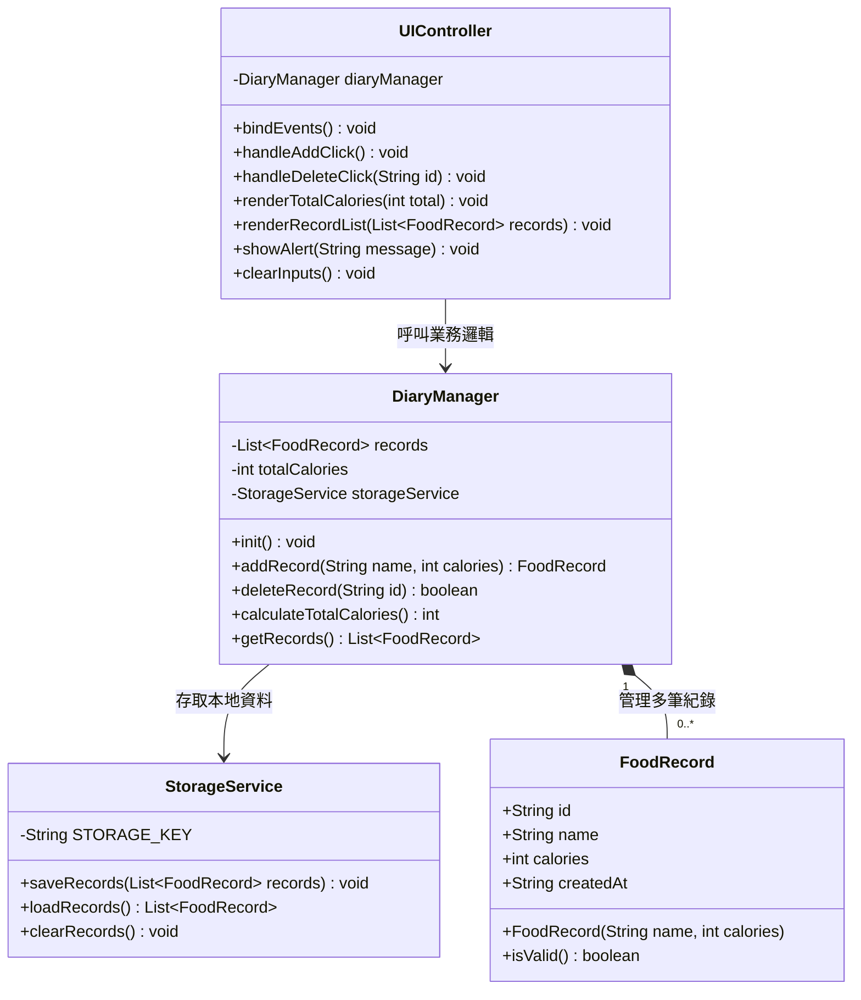
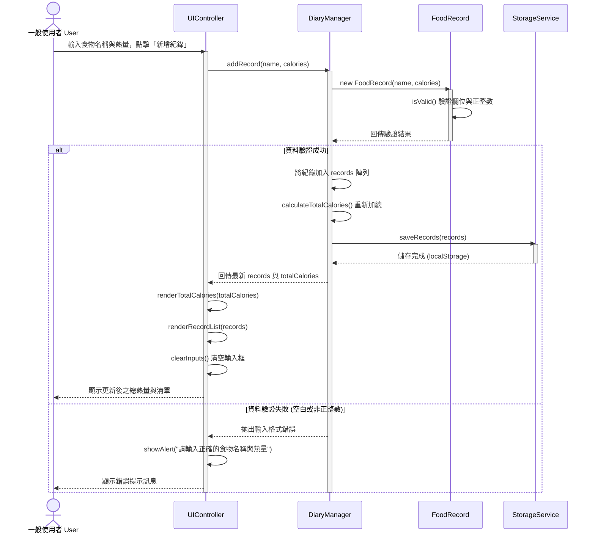
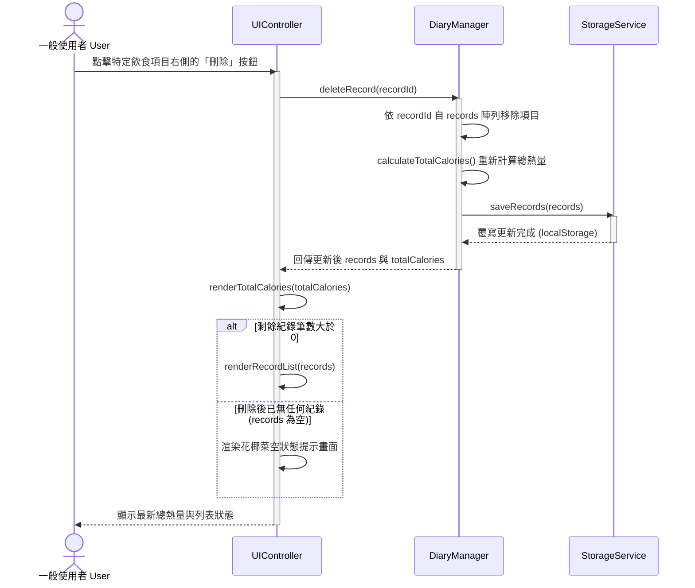
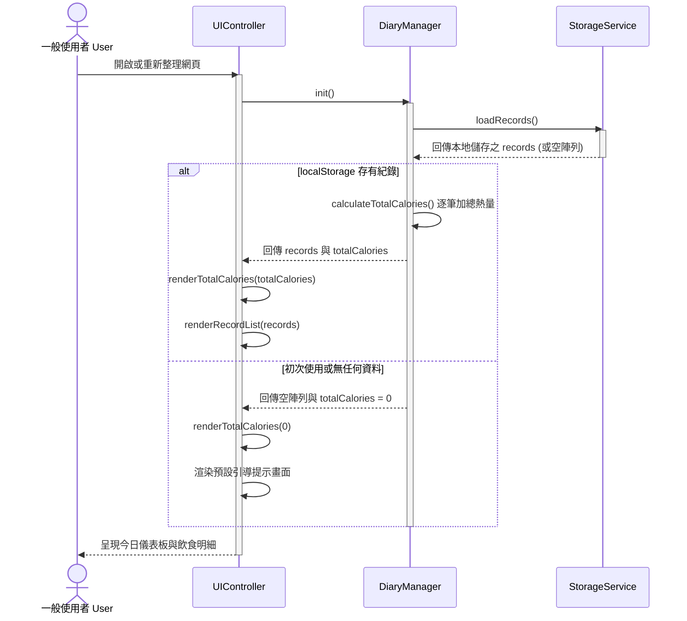
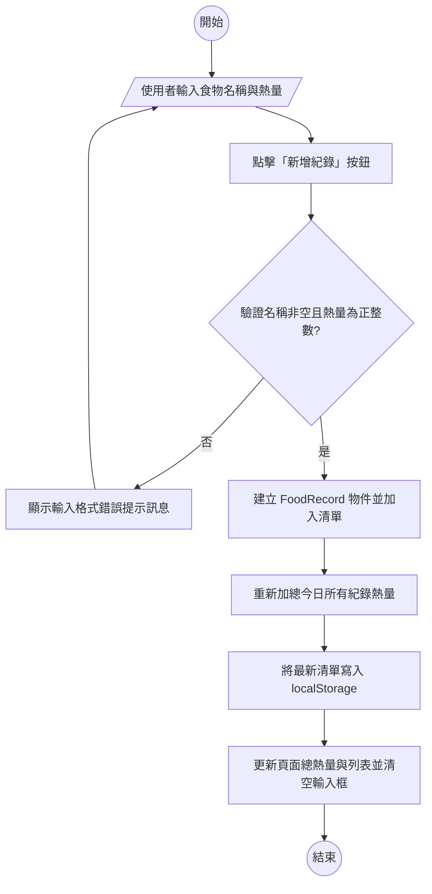
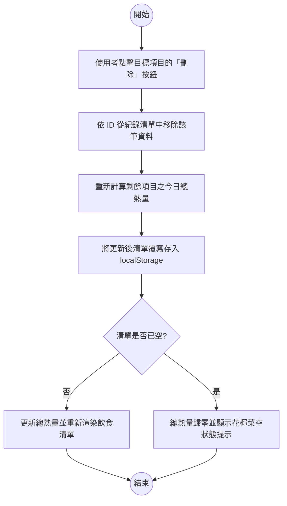
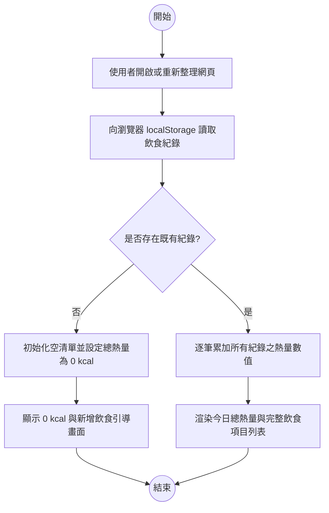

# 作業 4：系統設計與 UML 行為建模

## 專題名稱
花椰菜的飲食日記（簡易飲食熱量追蹤系統）

---

## 一、UML 類別圖（Class Diagram）

本系統採用前端物件導向模組化設計，將資料模型（ `FoodRecord` ）、核心業務與狀態管理（ `DiaryManager` ）、瀏覽器本地儲存介面（ `StorageService` ）以及畫面渲染控制器（ `UIController` ）職責分離：


---

## 二、UML 循序圖（Sequence Diagrams）

### 1. 新增飲食紀錄流程



### 2. 刪除飲食紀錄流程


### 3. 頁面初始化與讀取本地資料流程

---

## 三、系統流程圖（Flowcharts）

### 1. 新增飲食流程


### 2. 刪除飲食流程


### 3. 網頁初始化載入流程
3.貼上修正後的完整內容：複製下方程式碼區塊。點擊下方程式碼區塊右上角的複製圖示，貼進空白的編輯框中（註：為了避免網頁外層框線提早截斷，貼上後請檢查每張圖表前後都有獨立的三個反引號包住）：Markdown# 作業 4：系統設計與 UML 行為建模

---

## 一、UML 類別圖（Class Diagram）

本系統採用前端物件導向模組化設計，將資料模型（ `FoodRecord` ）、核心業務與狀態管理（ `DiaryManager` ）、瀏覽器本地儲存介面（ `StorageService` ）以及畫面渲染控制器（ `UIController` ）職責分離：
```mermaid
classDiagramclass FoodRecord {+String id+String name+int calories+String createdAt+FoodRecord(String name, int calories)+isValid() boolean}class DiaryManager {
    -List~FoodRecord~ records
    -int totalCalories
    -StorageService storageService
    +init() void
    +addRecord(String name, int calories) FoodRecord
    +deleteRecord(String id) boolean
    +calculateTotalCalories() int
    +getRecords() List~FoodRecord~
}

class StorageService {
    -String STORAGE_KEY
    +saveRecords(List~FoodRecord~ records) void
    +loadRecords() List~FoodRecord~
    +clearRecords() void
}

class UIController {
    -DiaryManager diaryManager
    +bindEvents() void
    +handleAddClick() void
    +handleDeleteClick(String id) void
    +renderTotalCalories(int total) void
    +renderRecordList(List~FoodRecord~ records) void
    +showAlert(String message) void
    +clearInputs() void
}

UIController --> DiaryManager : 呼叫業務邏輯
DiaryManager --> StorageService : 存取本地資料
DiaryManager "1" *-- "0..*" FoodRecord : 管理多筆紀錄
```
---

## 二、UML 循序圖（Sequence Diagrams）

### 1. 新增飲食紀錄流程

```mermaid
sequenceDiagramactor User as 一般使用者 Userparticipant UI as UIControllerparticipant Manager as DiaryManagerparticipant Record as FoodRecordparticipant Storage as StorageServiceUser->>UI: 輸入食物名稱與熱量，點擊「新增紀錄」
activate UI
UI->>Manager: addRecord(name, calories)
activate Manager
Manager->>Record: new FoodRecord(name, calories)
activate Record
Record->>Record: isValid() 驗證欄位與正整數
Record-->>Manager: 回傳驗證結果
deactivate Record

alt 資料驗證成功
    Manager->>Manager: 將紀錄加入 records 陣列
    Manager->>Manager: calculateTotalCalories() 重新加總
    Manager->>Storage: saveRecords(records)
    activate Storage
    Storage-->>Manager: 儲存完成 (localStorage)
    deactivate Storage
    Manager-->>UI: 回傳最新 records 與 totalCalories
    UI->>UI: renderTotalCalories(totalCalories)
    UI->>UI: renderRecordList(records)
    UI->>UI: clearInputs() 清空輸入框
    UI-->>User: 顯示更新後之總熱量與清單
else 資料驗證失敗 (空白或非正整數)
    Manager-->>UI: 拋出輸入格式錯誤
    UI->>UI: showAlert("請輸入正確的食物名稱與熱量")
    UI-->>User: 顯示錯誤提示訊息
end
deactivate Manager
deactivate UI

### 2. 刪除飲食紀錄流程

```mermaid
sequenceDiagramactor User as 一般使用者 Userparticipant UI as UIControllerparticipant Manager as DiaryManagerparticipant Storage as StorageServiceUser->>UI: 點擊特定飲食項目右側的「刪除」按鈕
activate UI
UI->>Manager: deleteRecord(recordId)
activate Manager
Manager->>Manager: 依 recordId 自 records 陣列移除項目
Manager->>Manager: calculateTotalCalories() 重新計算總熱量
Manager->>Storage: saveRecords(records)
activate Storage
Storage-->>Manager: 覆寫更新完成 (localStorage)
deactivate Storage
Manager-->>UI: 回傳更新後 records 與 totalCalories
deactivate Manager

UI->>UI: renderTotalCalories(totalCalories)
alt 剩餘紀錄筆數大於 0
    UI->>UI: renderRecordList(records)
else 刪除後已無任何紀錄 (records 為空)
    UI->>UI: 渲染花椰菜空狀態提示畫面
end
UI-->>User: 顯示最新總熱量與列表狀態
deactivate UI
```

### 3. 頁面初始化與讀取本地資料流程

```mermaid
sequenceDiagramactor User as 一般使用者 Userparticipant UI as UIControllerparticipant Manager as DiaryManagerparticipant Storage as StorageServiceUser->>UI: 開啟或重新整理網頁
activate UI
UI->>Manager: init()
activate Manager
Manager->>Storage: loadRecords()
activate Storage
Storage-->>Manager: 回傳本地儲存之 records (或空陣列)
deactivate Storage

alt localStorage 存有紀錄
    Manager->>Manager: calculateTotalCalories() 逐筆加總熱量
    Manager-->>UI: 回傳 records 與 totalCalories
    UI->>UI: renderTotalCalories(totalCalories)
    UI->>UI: renderRecordList(records)
else 初次使用或無任何資料
    Manager-->>UI: 回傳空陣列與 totalCalories = 0
    UI->>UI: renderTotalCalories(0)
    UI->>UI: 渲染預設引導提示畫面
end
deactivate Manager
UI-->>User: 呈現今日儀表板與飲食明細
deactivate UI
```
---

## 三、系統流程圖（Flowcharts）

### 1. 新增飲食流程

```mermaid
flowchart TDStart((開始)) --> Input[/使用者輸入食物名稱與熱量/]Input --> Click[點擊「新增紀錄」按鈕]Click --> Validate{驗證名稱非空且熱量為正整數?}Validate -- 否 --> Alert[顯示輸入格式錯誤提示訊息]
Alert --> Input

Validate -- 是 --> CreateObj[建立 FoodRecord 物件並加入清單]
CreateObj --> Calc[重新加總今日所有紀錄熱量]
Calc --> Save[將最新清單寫入 localStorage]
Save --> Render[更新頁面總熱量與列表並清空輸入框]
Render --> End((結束))
```

### 2. 刪除飲食流程
```mermaid
flowchart TDStart((開始)) --> Select[使用者點擊目標項目的「刪除」按鈕]Select --> Remove[依 ID 從紀錄清單中移除該筆資料]Remove --> Recalc[重新計算剩餘項目之今日總熱量]Recalc --> Save[將更新後清單覆寫存入 localStorage]Save --> CheckEmpty{清單是否已空?}CheckEmpty -- 否 --> RenderList[更新總熱量並重新渲染飲食清單]
CheckEmpty -- 是 --> RenderEmpty[總熱量歸零並顯示花椰菜空狀態提示]

RenderList --> End((結束))
RenderEmpty --> End
```

### 3. 網頁初始化載入流程

